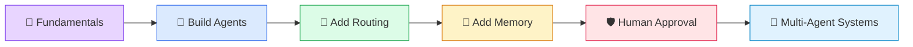
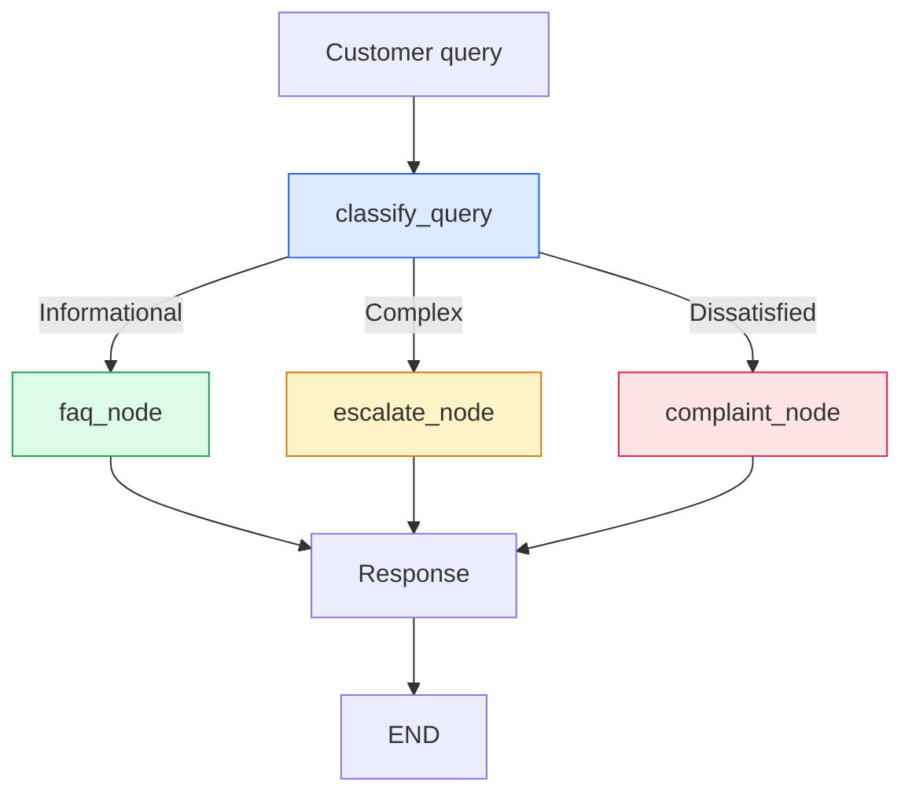
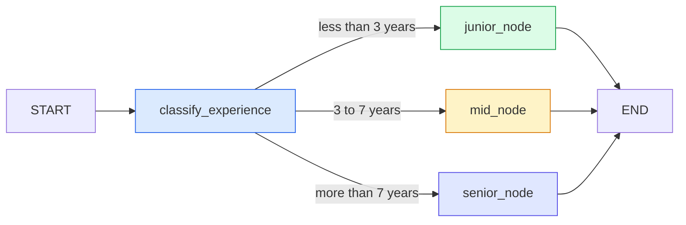
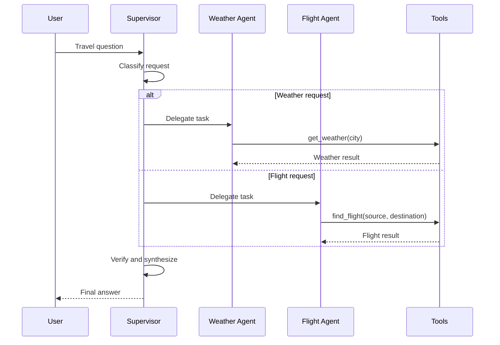
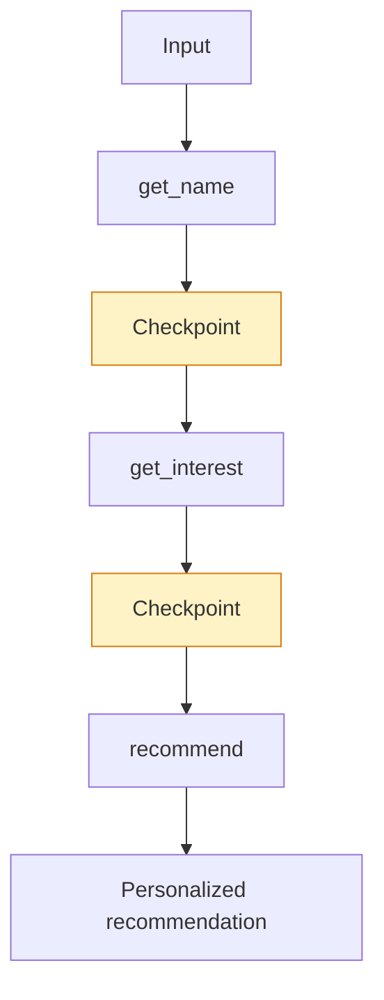
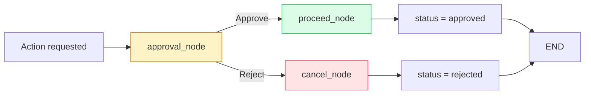

# 🧠 LangGraph Learning Lab

[](https://langchain-ai.github.io/langgraph/)
[](https://www.python.org/)
[](https://jupyter.org/)
[](https://colab.research.google.com/github/Prktriesitout/LangGraph/)

> A hands-on collection of LangGraph notebooks covering stateful agents, conditional routing, tools, memory, human approval, persistence, and multi-agent supervision.

---

## ✨ What This Repository Covers

| Area | Key concepts demonstrated |
|---|---|
| **Core Graphs** | `StateGraph`, typed state, nodes, entry points, conditional edges, `START`, `END` |
| **Agent Patterns** | ReAct agents, tool calling, supervisor agents, subgraphs, and tool routing |
| **Memory** | Short-term thread memory, long-term memory, `MemorySaver`, `SqliteSaver`, and checkpoints |
| **Human-in-the-Loop** | Interrupts, approval flows, draft review, resume with `Command` |
| **Practical Projects** | Customer support, HR routing, persistent sales chat, and travel supervision |

---

## 🗺️ Learning Journey



---

## 📓 Notebook Index

| Notebook | Level | What it teaches | Open |
|---|---:|---|:---|
| [`LangGraphworkflow.ipynb`](./LangGraphworkflow.ipynb) | Core | State, nodes, edges, streaming, persistence, time travel, tools, interrupts, memory, and Graph/Functional APIs | [](https://colab.research.google.com/github/Prktriesitout/LangGraph/blob/main/LangGraphworkflow.ipynb) |
| [`Langraph.ipynb`](./Langraph.ipynb) | Intermediate | Agents, hooks, schemas, ReAct tool loops, news and code tools, supervisor workflows, and prebuilt agents | [](https://colab.research.google.com/github/Prktriesitout/LangGraph/blob/main/Langraph.ipynb) |
| [`Langgraph6.ipynb`](./Langgraph6.ipynb) | Intermediate | Short-term and long-term-style conversational memory with OpenAI, profile extraction, and recalled context | [](https://colab.research.google.com/github/Prktriesitout/LangGraph/blob/main/Langgraph6.ipynb) |
| [`LanggraphProject2.ipynb`](./LanggraphProject2.ipynb) | Project | Sales chatbot state persistence across restarts using SQLite-backed checkpoints | [](https://colab.research.google.com/github/Prktriesitout/LangGraph/blob/main/LanggraphProject2.ipynb) |
| [`Project1Langgraph.ipynb`](./Project1Langgraph.ipynb) | Project | Customer support routing for FAQ, escalation, and complaint paths | [](https://colab.research.google.com/github/Prktriesitout/LangGraph/blob/main/Project1Langgraph.ipynb) |
| [`Project4Langgraph.ipynb`](./Project4Langgraph.ipynb) | Project | Travel assistant with ReAct weather and flight agents coordinated by a supervisor | [](https://colab.research.google.com/github/Prktriesitout/LangGraph/blob/main/Project4Langgraph.ipynb) |
| [`Project5Langgraph.ipynb`](./Project5Langgraph.ipynb) | Project | Conditional HR routing by candidate experience level | [](https://colab.research.google.com/github/Prktriesitout/LangGraph/blob/main/Project5Langgraph.ipynb) |

---

## 🏗️ Project Workflows

### 🎧 Customer Support Router

The support workflow classifies each request and sends it to the correct specialist node.



**Relevant notebook:** [`Project1Langgraph.ipynb`](./Project1Langgraph.ipynb)

---

### 🧑‍💼 HR Experience Router

The HR graph uses experience thresholds to select the most appropriate response path.



**Relevant notebook:** [`Project5Langgraph.ipynb`](./Project5Langgraph.ipynb)

---

### 🧳 Travel Supervisor

A supervisor interprets the request and delegates it to a specialized ReAct agent.



**Relevant notebook:** [`Project4Langgraph.ipynb`](./Project4Langgraph.ipynb)

---

### 🛒 Sales Chat Persistence

The sales workflow checkpoints state so it can continue after an interruption or restart.



**Relevant notebook:** [`LanggraphProject2.ipynb`](./LanggraphProject2.ipynb)

---

### 🛡️ Human-in-the-Loop Approval

Sensitive actions pause for approval, then resume along an approved or rejected path.



**Relevant notebook:** [`LangGraphworkflow.ipynb`](./LangGraphworkflow.ipynb)

---

## 🚀 Getting Started

### Option 1: Run in Google Colab

1. Open any notebook using its **Colab** badge.
2. Run the first installation cell.
3. Add the required API key to Colab Secrets when prompted.
4. Restart the runtime if a package is installed for the first time.
5. Run cells in order.

### Option 2: Run Locally

```bash
git clone https://github.com/Prktriesitout/LangGraph.git
cd LangGraph
python -m venv .venv
source .venv/bin/activate
pip install jupyter langgraph langchain-core
pip install langchain-openai langchain-cohere langgraph-supervisor
jupyter notebook
```

For Windows PowerShell, activate the environment with:

```powershell
.venv\Scripts\Activate.ps1
```

---

## 🔑 Environment Variables

Not every notebook requires a model provider, but the LLM-backed examples commonly use:

```bash
OPENAI_API_KEY=your_openai_key
COHERE_API_KEY=your_cohere_key
TAVILY_API_KEY=your_tavily_key
```

In Google Colab, prefer **Colab Secrets** and retrieve values through `google.colab.userdata`.

> **Security:** Never commit API keys or notebook outputs that expose credentials.

---

## 📦 Main Dependencies

- **LangGraph** — graph runtime, state, nodes, edges, checkpoints, and interrupts
- **LangChain Core** — messages, tools, prompts, and runnable interfaces
- **LangChain OpenAI** — OpenAI chat models
- **LangChain Cohere** — Cohere chat and embedding models
- **LangGraph Supervisor** — supervisor-based multi-agent coordination
- **SQLite** — durable local state for persistence examples
- **Jupyter / Google Colab** — interactive notebook environment

---

## 🧩 Core LangGraph Pattern

```python
from typing import TypedDict
from langgraph.graph import StateGraph, START, END


class State(TypedDict):
    query: str
    response: str


def process(state: State) -> dict:
    return {"response": f"Received: {state['query']}"}


builder = StateGraph(State)
builder.add_node("process", process)
builder.add_edge(START, "process")
builder.add_edge("process", END)

app = builder.compile()
result = app.invoke({"query": "Hello", "response": ""})
```

---

## 🧭 Repository Structure

```text
LangGraph/
├── LangGraphworkflow.ipynb       # Complete workflow concepts and HITL examples
├── Langraph.ipynb                # Agents, tools, hooks, and supervisors
├── Langgraph6.ipynb              # Conversational memory example
├── LanggraphProject2.ipynb       # SQLite-backed sales chatbot
├── Project1Langgraph.ipynb       # Customer support conditional routing
├── Project4Langgraph.ipynb       # Travel multi-agent supervisor
├── Project5Langgraph.ipynb       # HR experience conditional routing
└── README.md
```

---

## ✅ Recommended Study Order

1. **Start with** [`LangGraphworkflow.ipynb`](./LangGraphworkflow.ipynb) for state, nodes, edges, and execution.
2. **Explore agents** in [`Langraph.ipynb`](./Langraph.ipynb).
3. **Study memory** in [`Langgraph6.ipynb`](./Langgraph6.ipynb).
4. **Practice routing** with [`Project1Langgraph.ipynb`](./Project1Langgraph.ipynb) and [`Project5Langgraph.ipynb`](./Project5Langgraph.ipynb).
5. **Add persistence** with [`LanggraphProject2.ipynb`](./LanggraphProject2.ipynb).
6. **Finish with supervision** in [`Project4Langgraph.ipynb`](./Project4Langgraph.ipynb).

---

## 🤝 Contributing

Suggestions, notebook improvements, diagrams, and bug fixes are welcome:

1. Create a feature branch.
2. Keep notebooks readable and run them from top to bottom.
3. Remove sensitive values and generated credentials.
4. Open a pull request with a short summary of the workflow changed.

---

<div align="center">

**Built to learn LangGraph from graph fundamentals to stateful multi-agent workflows.**

[](https://github.com/Prktriesitout/LangGraph)

</div>
